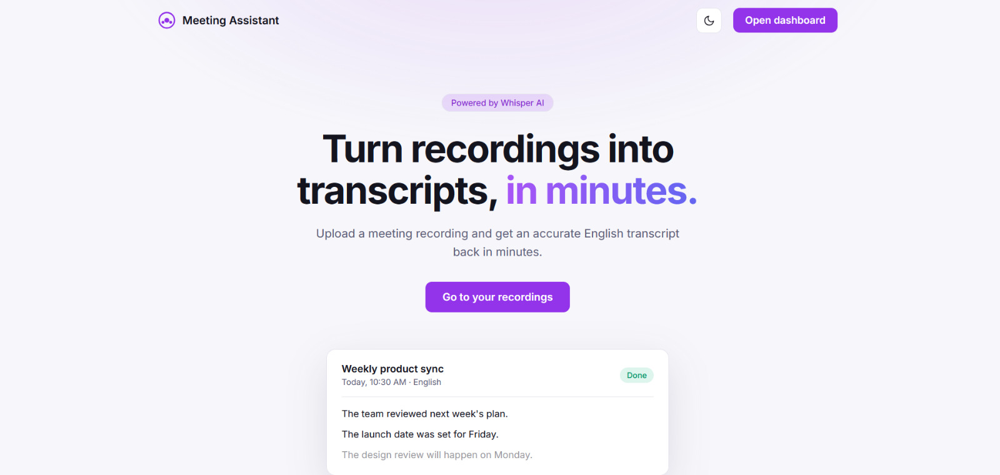
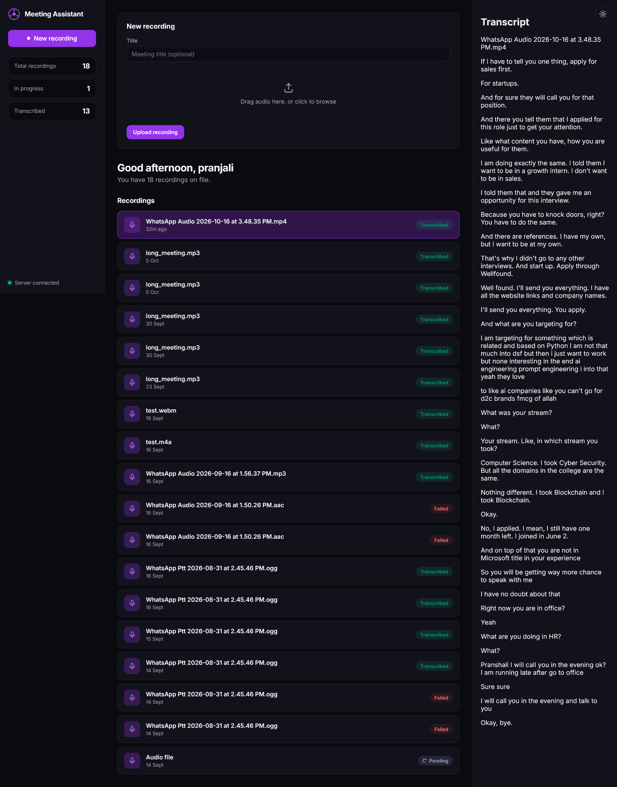
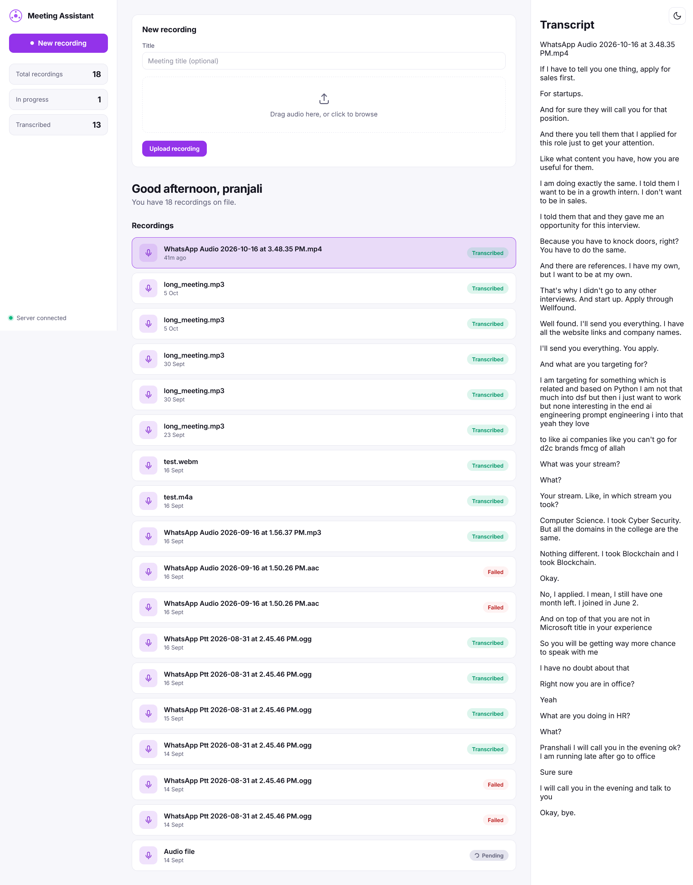
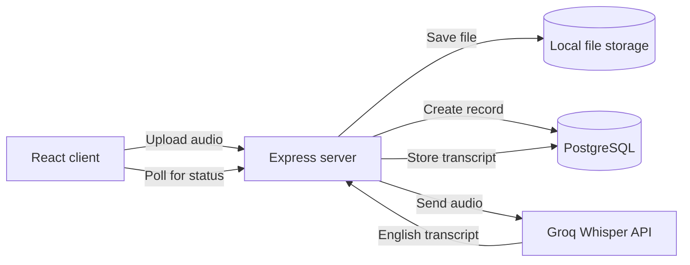

# Meeting Assistant

Upload a meeting recording in any spoken language and get an English transcript back in minutes. Built with React, Express, PostgreSQL and Groq's Whisper API.



## Features

- **Transcription in English** from audio in any spoken language, using Whisper large-v3 on Groq
- **Accounts:** sign up and log in, with a protected dashboard
- **Dashboard:** upload by drag and drop, live status (Pending, Transcribing, Transcribed, Failed) and a transcript viewer
- **Light and dark themes** with a switch that remembers each visitor's choice
- **Common audio formats:** mp3, wav, m4a, ogg, webm, flac and more

## Screenshots

| Dashboard (dark) | Dashboard (light) |
| --- | --- |
|  |  |

## Tech stack

| Layer | Technology |
| --- | --- |
| Frontend | React, TypeScript, Vite, React Router |
| Backend | Node.js, Express, TypeScript |
| Database | PostgreSQL (Docker), Prisma ORM |
| Transcription | Groq API, Whisper large-v3 |

## Architecture



The client uploads a file and gets an immediate response. The server transcribes in the background and updates the recording's status, and the dashboard polls until it reads "Transcribed".

## Getting started

### Prerequisites

- Node.js 18 or newer
- Docker Desktop
- A free [Groq API key](https://console.groq.com)

### 1. Clone and install

```bash
git clone https://github.com/pranjalishantveer/ai-meeting-assistant.git
cd ai-meeting-assistant

cd server && npm install
cd ../client && npm install
```

### 2. Configure environment variables

Copy `server/.env.example` to `server/.env`:

```bash
copy server\.env.example server\.env
```

Then fill in the values:

| Variable | Description |
| --- | --- |
| `PORT` | Server port (default `4000`) |
| `DATABASE_URL` | PostgreSQL connection string. The default matches `docker-compose.yml` |
| `GROQ_API_KEY` | Your free key from [console.groq.com/keys](https://console.groq.com/keys) |
| `JWT_SECRET` | A long random string used to sign login sessions |

Generate a `JWT_SECRET` with:

```bash
node -e "console.log(require('crypto').randomBytes(32).toString('hex'))"
```

Never commit your real `.env` file.

### 3. Start the database

```bash
docker compose up -d
```

### 4. Set up the database tables

```bash
cd server
npx prisma generate
npx prisma db push
```

### 5. Run the app

In one terminal:

```bash
cd server
npm run dev
```

In a second terminal:

```bash
cd client
npm run dev
```

Open [http://localhost:5173](http://localhost:5173). The server runs on port 4000.

## Project structure

```
.
├── client/                 React frontend
│   └── src/
│       ├── App.tsx             Routes
│       ├── HomePage.tsx        Landing page
│       ├── AuthPage.tsx        Login and sign up
│       ├── Dashboard.tsx       Main dashboard
│       ├── UploadForm.tsx      Audio upload
│       ├── RecordingList.tsx   Recordings and status
│       ├── DetailPanel.tsx     Transcript viewer
│       └── ThemeToggle.tsx     Light and dark switch
└── server/                 Express backend
    ├── prisma/schema.prisma    Database models
    └── src/
        ├── index.ts            Server entry point
        ├── auth.ts             Sign up and login
        ├── meetings.ts         Upload and recordings API
        ├── groq.ts             Whisper transcription
        └── upload.ts           File upload handling
```

## API

| Method | Endpoint | Description |
| --- | --- | --- |
| POST | `/api/meetings` | Upload an audio file (`audio`) with an optional `title` |
| GET | `/api/meetings` | List recordings, newest first |
| GET | `/api/meetings/:id` | One recording with its transcript |

## Roadmap

- Show each user only their own recordings
- Log out button
- Meeting summaries and action items
- Transcripts in languages other than English

## License

MIT